# zmk-config-corne

ZMK-прошивка Corne 3x6+3 (nice!nano v2). Основа — Miryoku + timeless home row mods (urob), внешние колонки под ЙЦУКЕН, клавиши EN/RU (F13/F14 → niri `switch-layout`).

Сборка: локально `./build-local.sh` (Docker, результат в `firmware/`) или GitHub Actions.
Схема: `uvx --from keymap-drawer keymap -c keymap-drawer/config.yaml parse -c 12 -z config/corne.keymap > keymap-drawer/corne.yaml`, затем `draw`.
